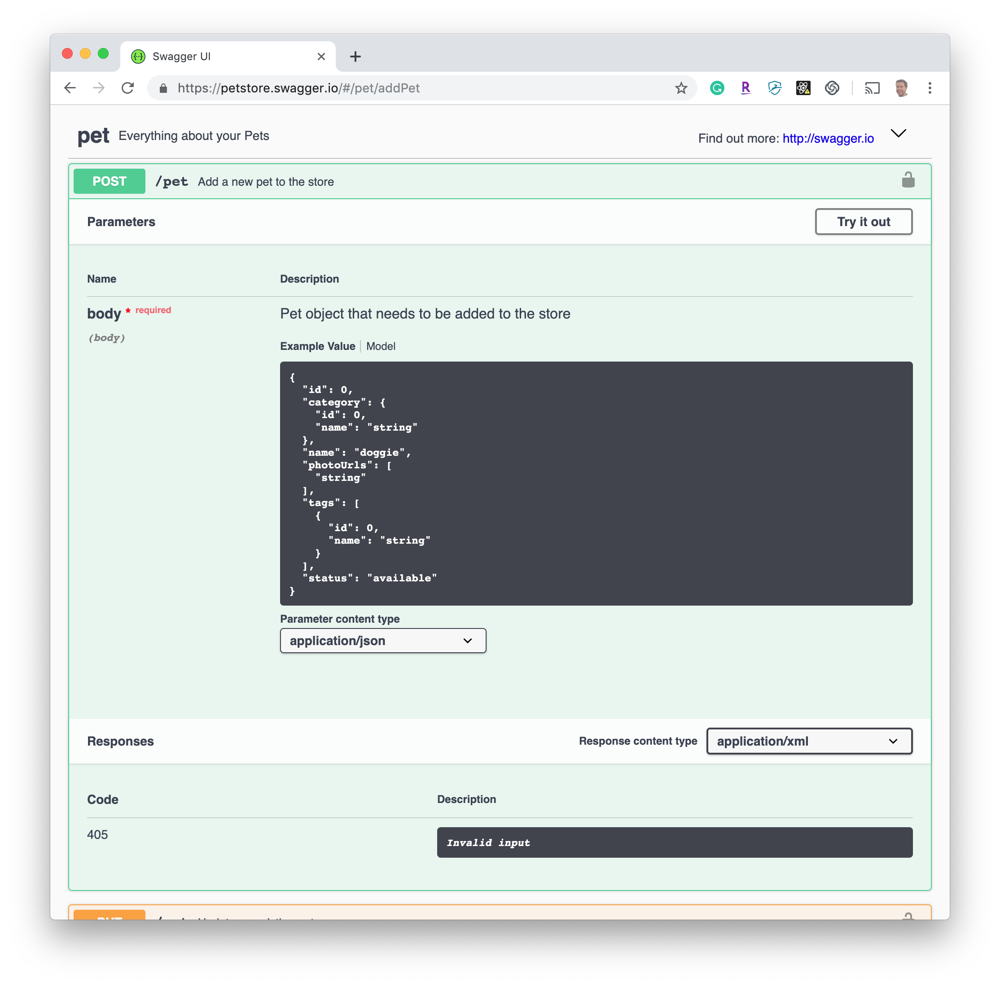
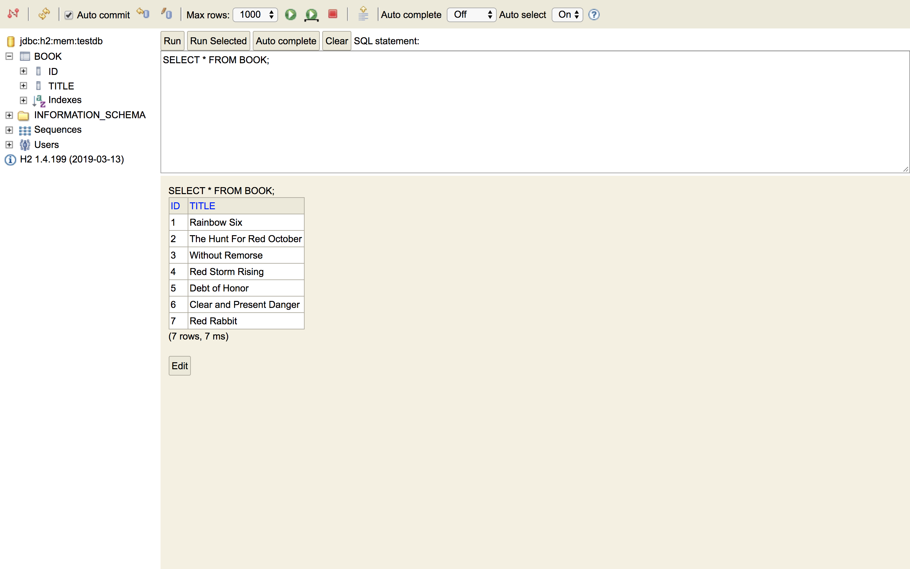

# <picture></picture> Swagger

When creating a REST API, good documentation is instrumental. Moreover, every change in the API should be simultaneously described in the reference documentation. Accomplishing this manually is a tedious exercise, so automation of the process was inevitable.

Swagger is a specification for documenting REST API. It specifies the format (URL, method, and representation) to describe REST web services.

Swagger provides a concise way for developers to get a high-level view of the entire API and then drill down to experiment with individual REST calls in a test environment.

[Here's a working example of a Swagger UI for a pet store](https://petstore.swagger.io/). 

Let's play around with it together. We'll walk through:
- GET
- POST
- DELETE

<!--**Instructor Note**: Head on over to the Swagger UI and play around with it. Show the students GET and POST (create new pet) and possibly DELETE to remove any pets (so sad!) you created. Explain how it can be viewed as a wrapper around ``curl`` (notice the curl commands that are displayed?).-->

Using that Swagger-generated UI, you can test the API by sending a POST message to the `/pet` resource to create a new pet. 



Here's a snippet of what the Swagger spec for the pet store looks like:

```json
{
  "swagger": "2.0",
  "info": {
    "description": "This is a sample server Petstore server.  You can find out more about Swagger at [http://swagger.io](http://swagger.io) or on [irc.freenode.net, #swagger](http://swagger.io/irc/).  For this sample, you can use the api key `special-key` to test the authorization filters.",
    "version": "1.0.0",
    "title": "Swagger Petstore",
    "termsOfService": "http://swagger.io/terms/",
    "contact": {
      "email": "apiteam@swagger.io"
    },
    "license": {
      "name": "Apache 2.0",
      "url": "http://www.apache.org/licenses/LICENSE-2.0.html"
    }
  },
  "paths": {
      "/pet": {
        "post": {
          "tags": [
            "pet"
          ],
          "summary": "Add a new pet to the store",
          "description": "",
          "operationId": "addPet",
          "consumes": [
            "application/json",
            "application/xml"
          ],
          "produces": [
            "application/xml",
            "application/json"
          ],
          "parameters": [
            {
              "in": "body",
              "name": "body",
              "description": "Pet object that needs to be added to the store",
              "required": true,
              "schema": {
                "$ref": "#/definitions/Pet"
              }
            }
          ],
          "responses": {
            "405": {
              "description": "Invalid input"
            }
          },
          "security": [
            {
              "petstore_auth": [
                "write:pets",
                "read:pets"
              ]
            }
          ]
        }
    }
  }
}
```

And here's [the full Swagger spec](swagger-petstore.json) for the Petstore API.

You can also use [Swagger Editor](https://swagger.io/tools/swagger-editor/download/) to design, define and document RESTful APIs in the Swagger Specification.

----

## Code Along

In this, we'll build documentation for the same simple Spring REST service using Swagger through a code-along exercise. Continue with the bookstore app you were working in the previous lesson.

Next, we'll create a Swagger spec for our app's REST API. Add Maven dependencies to `pom.xml` for Swagger to import all of the associated libraries. 

Notice that we're using a **snapshot** version (greater than 3.0.0) instead of a release version to avoid [this bug](https://github.com/springfox/springfox/issues/2345):

```xml
<dependencies> 
    <dependency>
        <groupId>io.springfox</groupId>
        <artifactId>springfox-swagger2</artifactId>
        <version>3.0.0-SNAPSHOT</version>
    </dependency>
    <dependency>
        <groupId>io.springfox</groupId>
        <artifactId>springfox-data-rest</artifactId>
        <version>3.0.0-SNAPSHOT</version>
    </dependency>
    <dependency>
        <groupId>io.springfox</groupId>
        <artifactId>springfox-swagger-ui</artifactId>
        <version>3.0.0-SNAPSHOT</version>
    </dependency>
</dependencies>    
```   

Swagger2 is an open-source project used to describe and document RESTful APIs. Currently, Springfox that has replaced Swagger-SpringMVC (Swagger 1.2 and older) is popular for Spring Boot applications.

We will use Swagger UI which is a built-in solution which makes user interaction with the Swagger-generated API documentation much easier.

With Spring Data REST you can rapidly create a REST API that exposes your Spring Data repositories and thus provides CRUD support and more. Springfox recently added a feature that creates a Swagger documentation for a Spring Data REST API.
    
You also need to include this Maven repo to pick up snapshot versions of dependencies. Add the code snippet below `<build>` tag in `pom.xml`:

```xml 
<repositories>
	<repository>
		<id>JFrog</id>
		<name>JFrog Snapshot Repository</name>
		<url>http://oss.jfrog.org/artifactory/oss-snapshot-local/</url>
	</repository>
</repositories>    
```
> A repository in Maven holds build artifacts and dependencies of varying types. What we are using here is a remote repository which has the dependencies with 3.0.0-SNAPSHOT version which are not yet released to central repository in Maven. You can read more about it [here](https://maven.apache.org/guides/introduction/introduction-to-repositories.html)

Create a new configuration class, `SwaggerConfig.java`, in `src/main/java/co/ga/bookstore` with the content below:

```java 
package co.ga.bookstore;
    
import org.springframework.context.annotation.Bean;
import org.springframework.context.annotation.Configuration;
import org.springframework.context.annotation.Import;
import springfox.documentation.builders.ApiInfoBuilder;
import springfox.documentation.builders.PathSelectors;
import springfox.documentation.builders.RequestHandlerSelectors;
import springfox.documentation.service.ApiInfo;
import springfox.documentation.spi.DocumentationType;
import springfox.documentation.spring.data.rest.configuration.SpringDataRestConfiguration;
import springfox.documentation.spring.web.plugins.Docket;
import springfox.documentation.swagger2.annotations.EnableSwagger2WebMvc;
    
@EnableSwagger2WebMvc
@Import({SpringDataRestConfiguration.class})
@Configuration
public class SwaggerConfig {
    
    @Bean
    public Docket api() {
        return new Docket(DocumentationType.SWAGGER_2)
                .select()
                .apis(RequestHandlerSelectors.basePackage("org.springframework.data.jpa.repository.support"))
                .paths(PathSelectors.any())
                .build()
                .apiInfo(apiEndPointsInfo());
    }
    
    private ApiInfo apiEndPointsInfo() {
        return new ApiInfoBuilder().title("Bookstore REST API")
                .description("Bookstore Management System's REST API")
                .version("1.0.0")
                .build();
    }
}    
```

**@EnableSwagger2WebMvc** indicates that Swagger support should be enabled. This should be applied to a Spring java config and should have an accompanying `@Configuration` annotation.

We have to define a Docket bean where its select() method returns an instance of `ApiSelectorBuilder`, which provides a way to control the endpoints exposed by Swagger. Predicates for selection of RequestHandlers can be configured with the help of RequestHandlerSelectors and PathSelectors. Using any() for both will make documentation for your entire API available through Swagger.

In the code, the `RequestHandlerSelectors.basePackage` predicate matches the `org.springframework.data.jpa.repository.support` base package to filter the API.

To build and run the application first create the jar then use java command to run it.

```sh
./mvnw clean package
java -jar ./target/bookstore-0.0.1-SNAPSHOT.jar    
```
>mvnw is a maven wrapper, allows you to run the Maven project without having Maven installed and present on the path. It downloads the correct Maven version if it's not found.
    
In another terminal window, have a look at the raw API with `curl`:

```sh
curl -v http://localhost:8080/
```
>curl is a tool to transfer data from or to a server, using one of the supported protocols.

Let's see what books we have in our database:
    
```sh
curl -v http://localhost:8080/books
```
    
Here are the books containing the `red` string in their title:
    
```sh
curl -v http://localhost:8080/books/search/byTitle?q=red
```

Below is where we'll find our Swagger spec for the API. Have a look at it "pretty printed" to the console with [jq](https://stedolan.github.io/jq/):
    
```sh
 curl -v http://localhost:8080/v2/api-docs | jq
```

> **Note**: Verify that jq is installed by running `jq --version`. If not, use Homebrew to install it (`brew install jq`).
    
Finally, let's find out how our Swagger UI looks in our web browser:
    
```sh
open http://localhost:8080/swagger-ui.html
```

You can also check the database at [http://localhost:8080/h2-console](http://localhost:8080/h2-console). Click on Connect.



### @ApiOpeartion

We'd like to add more documentation about what our API does. So, let's annotate our `BookRepository` with [`@ApiOperation`](https://github.com/swagger-api/swagger-core/wiki/Annotations-1.5.X#apioperation). 

The @ApiOperation is used to declare a single operation. An operation is considered a unique combination of a path and a HTTP method.

Add the relevant `import` statement in `BookRepository.java` as well:

```java 
    import io.swagger.annotations.ApiOperation;
    ...
    ...
    
    @RepositoryRestResource
    public interface BookRepository extends CrudRepository<Book, Long> {
    
        @RestResource(path = "byTitle")
        @ApiOperation("find all books that contain the string q in their title, ignoring case")
        List<Book> findByTitleIgnoreCaseContaining(@Param("q") String q);
	
    }    
```

**@RepositoryRestResource** is used to set options on the public Repository interface - it will automatically create endpoints as appropriate based on the type of Repository that is being extended (i.e. CrudRepository/PagingAndSortingRepository/etc). So if you are using @RepositoryRestResource then there is no need to make Service/Controller layer.
        
Rebuild everything and run the application:

```sh 
./mvnw clean package
java -jar ./target/bookstore-0.0.1-SNAPSHOT.jar
```
    
Open Swagger UI in another terminal window (or just refresh your existing browser window). Click on individual services for more details:

```sh
open http://localhost:8080/swagger-ui.html
```  

### You Do

- Continue adding [more annotations](https://github.com/swagger-api/swagger-core/wiki/Annotations-1.5.X) to document the API.
- Execute calls to your REST API from within the Swagger interface. Run a `GET` to view all books or one specific book, create or update a book, search for a book — all through the Swagger UI.

#### References 

- [Springfox Reference Documentation](https://springfox.github.io/springfox/docs/current/)

### Additional Reading
[Microservices, APIs, and Swagger: How They Fit Together](https://swagger.io/blog/api-strategy/microservices-apis-and-swagger/)

[Microservices API Documentation with Swagger2](https://piotrminkowski.wordpress.com/2017/04/14/microservices-api-documentation-with-swagger2/)

[Centralized API Documentation in Microservices](https://dzone.com/articles/centralized-documentation-in-microservice-spring-b)
