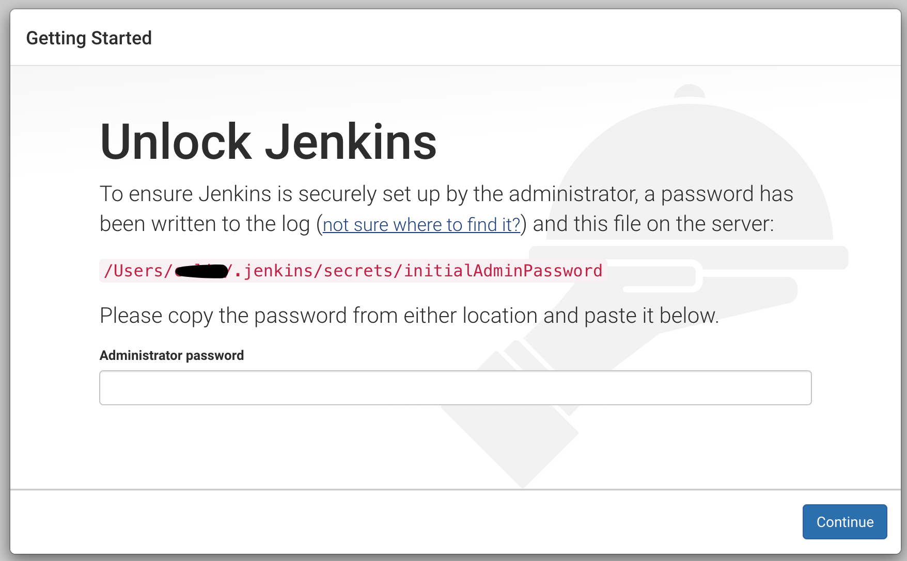
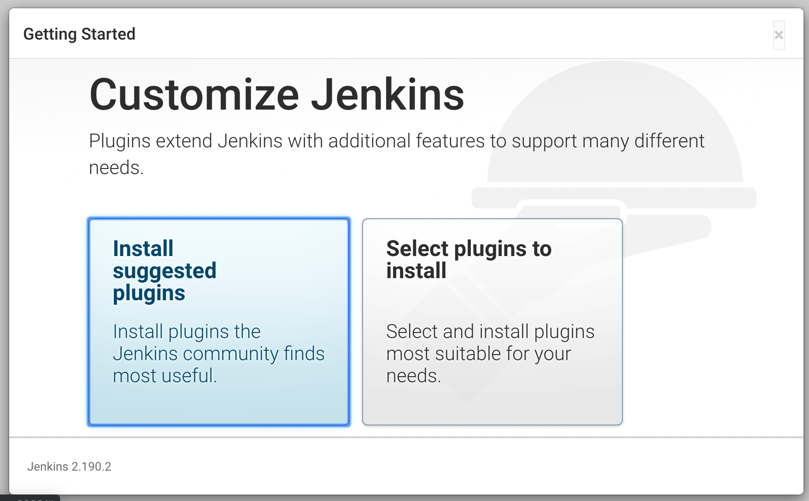
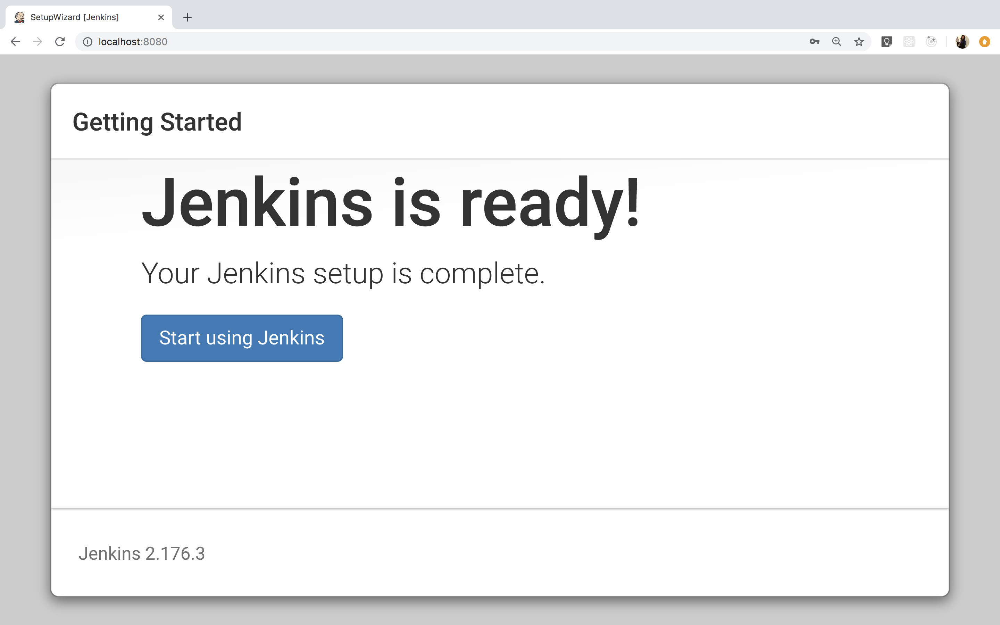
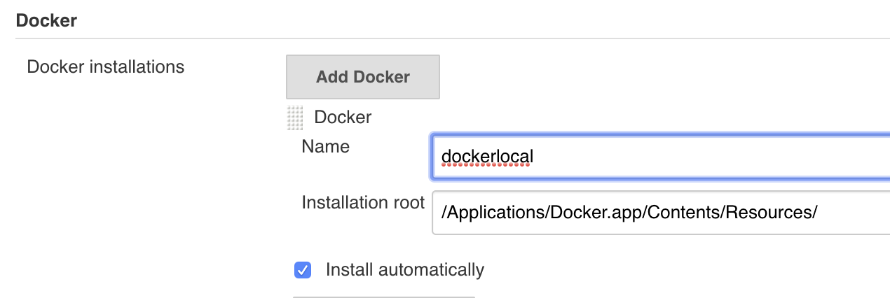
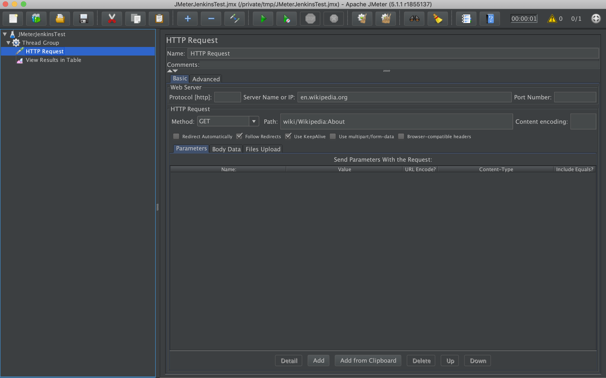

# <picture></picture> Lab: Working With Jenkins

## Overview

In this lab, we'll walk through a few functionalities in Jenkins:
- Installing Jenkins. 
- Creating pipelines.
- Working with JMeter and the Performance plugin.

----

## Run Jenkins 

In this part of the lab, we'll install Jenkins with [Homebrew](https://brew.sh/).

1. Open the terminal and run the following command:

    ```sh 
    brew install jenkins-lts
    ```  
2. Then, start the server using this command...

    ```sh
    jenkins-lts
    ```
    
    ...or this command\*:
    
    ```sh
    brew services start jenkins-lts
    ```
    \*Note that running `brew services` requires `homebrew-services` to be installed. If it's not already installed, running the previous line with `sudo` will install it.
    
    If you get an error, make sure that a server is not already running on port 8080, as indicated by the message `java.net.BindException: Address already in use`. 

3. If you started it with `jenkins-lts`, from the terminal output copy the automatically generated alphanumeric password between the two sets of asterisks:

    ```text
    *************************************************************
    *************************************************************
    *************************************************************

    Jenkins initial setup is required. An admin user has been created and a password generated.
    Please use the following password to proceed to installation:

    54b2e3x995b82257a36e97989440ea74

    This may also be found at: /var/jenkins_home/secrets/initialAdminPassword

    *************************************************************
    *************************************************************
    *************************************************************
    ```
If you started it as a service, you can find the password with 
```less ~/.jenkins/secrets/initialAdminPassword```

4. Next, open the browser and go to [http://localhost:8080](http://localhost:8080). The **`Unlock Jenkins`** page should load, asking for the administrator password. Paste the password you copied from your terminal.



Click on `Continue`. On the next screen, install the suggested plugins:



If one or more of the plugin installations fail, you might be operating behind a proxy or firewall that doesn't allow them. One workaround is to fire up a personal VPN. Another is to change your network by trying from a different location, or from a cellular connection.

Then create an admin user.

Click on `Save and Continue`, then, on the next screen, just click `Save and Finish`.

You'll be redirected to the home page. Click on `Start using Jenkins`.



At this point you may need to actually stop and start the service again, and then revisit localhost:8080.

5. Install Blue Ocean as per the instructions [here](https://jenkins.io/doc/book/blueocean/getting-started/#installing-blue-ocean).

6. On certain systems, including MacOS, you need to manually set the path to `docker`:
a. Click "Manage Jenkins", or "Administration" if you are in Blue Ocean.
b. Click "Global Tool Configuration".
c. Scroll down to "Docker" and click "Add Docker".
d. Enter any label and then an "Installation Root" of `/Applications/Docker.app/Contents/Resources/`. If yours is not located there, you need to enter the path that holds the `bin` directory, which holds the `docker` executable. Note, this probably isn't the directory displayed by the `which docker` command.
e. Check "Install automatically".
f. Click "Save".



---

## Create a Pipeline

A [**pipeline**](https://jenkins.io/doc/book/pipeline/) is a suite of plugins that supports implementing and integrating continuous delivery pipelines into Jenkins.

A **continuous delivery (CD) pipeline** is an automated expression of your process for getting software from version control to your users and customers. Every change to your software (committed in source control) goes through a complex process on its way to being released. This process involves building the software in a reliable and repeatable manner, as well as progressing the built software (called a **build**) through multiple stages of testing and deployment.

To start, we'll build a sample Java application with Maven. 

Fork [this repository](https://github.com/jenkins-docs/simple-java-maven-app) into your own GitHub account and clone the code.

Once the application is set up:

1. Go back to the Jenkins home page ([http://localhost:8080](http://localhost:8080)). Scroll down to the end and click **`Create new jobs`** under **`Welcome to Jenkins!`**.
1. Specify a name for your pipeline (e.g., `simple-java-maven-app`).
1. Scroll down and click **`Pipeline`**, then click `OK` at the end of the page.
1. Scroll down to the `Pipeline` section. You can also click on the `Pipeline` tab. Choose the **`Pipeline script from SCM`** option.
1. From the **`SCM`** field, choose **`Git`**.
1. In the **`Repository URL`** field, specify the GitHub URL from where you locally cloned the `simple-java-maven-app` repository.
1. Click **`Save`**.

After creating a pipeline project, follow the steps below to create a `Jenkinsfile` and automate building the `simple-java-maven-app` application. This file will then be checked in and committed to our locally cloned Git repository. In this way, our pipeline becomes part of the application and is reviewed and versioned like any other code. Refer to the [Using the `Jenkinsfile`](https://jenkins.io/doc/book/pipeline/jenkinsfile) documentation for more information.  

1. Open the terminal and create a new `Jenkinsfile` file at the root of the `simple-java-maven-app` repository:

```sh
touch Jenkinsfile
```

2. Open the file in any editor you want, then copy and paste the following code into the empty `Jenkinsfile`:

```text
pipeline {
    agent {
        docker {
            image 'maven:3-alpine'
            args ' -v /tmp/.m2:/tmp/.m2'
        }
    }
    stages {
        stage('Build') {
            steps {
                sh 'mvn -B -DskipTests clean package'
            }
        }
    }
}
```

Let's break down the contents of the `Jenkinsfile`:   

  - The `image` parameter downloads the `maven:3-alpine` Docker image and runs it as a separate container. 
  - The `args` parameter creates a mapping between the Maven repository (`/tmp/.m2`) directories in the short-lived Maven Docker container and that of your Docker host's file system and prevents downloading the same Maven artifacts again whenever the pipeline is run. 
  - The `sh` step under the `stage` directive runs the Maven command to build the application.
  
3. Save, commit, and push `Jenkinsfile` to the GitHub repository:

```sh
git add .
git commit -m 'Added initial Jenkinsfile'
git push origin master
```

4. Go to the Jenkins home page and click **`Open Blue Ocean`** on the left.
5. In the **`This job has not been run`** message box, click **`Run`**, then quickly click the **`OPEN`** link that briefly appears on the lower right to see Jenkins running your pipeline project. This may take several minutes, as it's the first run. 
  
The Blue Ocean interface turns green if Jenkins built your Java application successfully:


6. Click the **`X`** at the top right to return to the main Blue Ocean interface:


7. Add a `test` and `deliver` stage as well as an `options` section to your pipeline by editing the `Jenkinsfile`, as shown below: 

```text
pipeline {
    agent {
        docker {
            image 'maven:3-alpine'
            args '-v /tmp/.m2:/tmp/.m2'
        }
    }
    options {
        skipStagesAfterUnstable()
    }
    stages {
        stage('Build') {
            steps {
                sh 'mvn -B -DskipTests clean package'
            }
        }
            stage('Test') {
                steps {
                    sh 'mvn test'
                }
                post {
                    always {
                        junit 'target/surefire-reports/*.xml'
                    }
                }
            }
            stage('Deliver') { 
                steps {
                    sh './jenkins/scripts/deliver.sh' 
                }
            }
    }
}
```

8. For the changes in the `Jenkinsfile` to take effect, you must save and commit it to your local `simple-java-maven-app` repository:

```sh
git stage .
git commit -m 'Add Deliver and Test stage'
git push
```

9. Finally, go back to the Jenkins home page, open the Blue Ocean interface, and click **`Run`** at the top left. Then, quickly click the **`OPEN`** link that briefly appears at the lower right to see the pipeline run details:  


Again, the Blue Ocean interface turns green if Jenkins built your Java application successfully.

You can click the **`X`** at the top right to return to the main Blue Ocean interface, which lists your previous pipeline runs in reverse chronological order.

---

## Working With JMeter

[Apache JMeter](https://jmeter.apache.org/) is meant to test functional behavior and measure performance. It was originally designed for testing web applications but has since expanded to other test functions.    

Creating new features can often lead to performance degradation or bugs. Adding performance tests greatly reduces the risk associated with introducing changes to our application. Any new commit that increases response times above a threshold will automatically trigger alerts and mark the build as failed, making it easy to identify and troubleshoot issues.     

### Install the JMeter Plugin

1. Download the latest version of the [Performance plugin](https://wiki.jenkins.io/display/JENKINS/Performance+Plugin):

    ```sh
    sudo pip3 install bzt
    git clone https://github.com/jenkinsci/performance-plugin.git performance
    cd performance
    mvn package
    ```   
      
    The command above should generate a `performance.hpi` file in the target directory.       
        
2. Copy the `performance.hpi` file to the plugins folder of your Jenkins installation (e.g., `~/.jenkins/plugins`):

    ```sh
    cp target/performance.hpi <path_to_jenkins>/plugins
    ```
     
3. [Restart Jenkins](https://stackoverflow.com/questions/8072700/how-to-restart-jenkins-manually) to detect and load the plugin.    

4. If the installation is successful, for new Freestyle jobs you should see the **`Publish Performance Test Result Report`** option under the **`Jenkins` -> `<your project name>` -> `Configure` -> `Build actions` -> `Add build step`** drop down.

    

### Create and Run JMeter Tests

1. Install JMeter with Homebrew:

```sh
brew install jmeter
```

2. Open JMeter:

```
jmeter
```

3. Create a JMeter test plan.
- Under `Test Plan`, enter a value for `Name` (e.g., `JMeterJenkinsTest`).
- On the left sidebar, right click on `JMeterJenkinsTest` -> `Add` -> `Threads (Users)` -> `Thread Group`. This is also available in the "Edit" menu.
- On the left sidebar, right click on `ThreadGroup` -> `Add` -> `Sampler` -> `HTTP Request`.
- Enter a value for `Server Name or IP` (e.g., `en.wikipedia.org`).
- Enter a value for `Path` (e.g., `wiki/Wikipedia:About`).
- On the left sidebar, right click on `ThreadGroup` -> `Add` -> `Listener` -> `View Results in Table`.



- Save the JMX file (e.g., `/tmp/JMeterJenkinsTest.jmx`).
- Run the test with `CMD+R`. You should see the test status as `Passed` in `View Results in Table` under the sidebar.
- Feel free to make copies of the HTTP request with different paths representing different pages on the same website to test the performance of multiple pages on a website.

4. Run the JMeter test from the terminal:

```sh
cd /usr/local/Cellar/jmeter/5.1.1/bin
jmeter -Jjmeter.save.saveservice.output_format=xml -n -t /tmp/JMeterJenkinsTest.jmx -l /tmp/TestResult1.jtl
```
    
Make sure there are no errors before proceeding to the next step.     

### Running JMeter Tests in Jenkins

1. Create a new job in Jenkins (e.g., `JMeterTestJob`).
2. Under `Build`, click `Add build step` -> `Execute Shell`.
3. Enter the value below in the `command` field. Change the path to JMX and JTL files as needed:

```text
cd /usr/local/Cellar/jmeter/5.1.1/bin
jmeter -Jjmeter.save.saveservice.output_format=xml -n -t /tmp/JMeterJenkinsTest.jmx -l /tmp/TestResult1.jtl
```

4. Under `Post-build Actions`, click `Add post-build action` -> `Public Performance test result report`.
5. Click `Add a new report` -> `JMeter`.
6. Under `Report` files, put the same path to JTL as earlier (e.g., `/tmp/TestResult1.jtl`).
7. Under `Performance` display, check the `Performance Per Test Case Mode` and `Show Throughput Chart` boxes.
8. Save and click `Build Now` to run the job .

Check the **`Console Output`** tab of the project to verify execution or get additional information.    

The JMeter log file and the `.jtl` results file are located under your project's workspace. 

## Bonus: Jenkins on PCF

Before moving forward, if you haven't yet go over [Deploying an Application with Cloud Foundry](../../building-for-cloud/pcf-deployment-lesson) lesson. It is important to go over the lesson linked here before going to the next step.

Go [here](https://jenkins.io/download/) and download `Generic Java Package (.war)`.

Connect to Cloud Foundry CLI if not done yet. Now deploy `Jenkins.war` using this [special buildpack](https://github.com/Altoros/cf-example-jenkins#using-jenkins-buildpack) on the terminal.

```
cf push <path_to_jenkins.war> -b https://github.com/Altoros/jenkins-buildpack -m 2G <unique_app_name>
```

For instance, `cf push -p jenkins.war -b https://github.com/Altoros/jenkins-buildpack -m 2G jenkins-chairat`


You should see something like this on the console,

```
Pushing app jenkins-chairat to org generalassembly / space development as isha.arora@generalassemb.ly...
Getting app info...
Creating app with these attributes...
+ name:         jenkins-chairat
  path:         /Users/ishaarora/Downloads/jenkins.war
  buildpacks:
+   https://github.com/Altoros/jenkins-buildpack
+ memory:       2G
  routes:
+   jenkins-chairat.cfapps.io

Creating app jenkins-chairat...
Mapping routes...
Comparing local files to remote cache...
Packaging files to upload...
Uploading files...
 3.25 MiB / 3.25 MiB [===================================================================] 100.00% 6s

Waiting for API to complete processing files...

Staging app and tracing logs...
   Cell a1f81d42-d292-4be1-bb41-a0b2e938f9bf creating container for instance babf94ab-d141-455c-98ec-04a1e25ebd1a
   Cell a1f81d42-d292-4be1-bb41-a0b2e938f9bf successfully created container for instance babf94ab-d141-455c-98ec-04a1e25ebd1a
   Downloading app package...
   Downloaded app package (74.6M)
   cat: /tmp/buildpackdownloads/33bbc852fcb5b983f2ec3eef5d6759f4/VERSION: No such file or directory
   -------> Buildpack version 
   -----> Extracting JRE.
   /tmp/app/vendor ~
   -----> Moving jre1.8.0_102 to target folder.
   ~
   -----> Repacking jenkins.war.
   /tmp/app ~
   ~
   -----> Building runtime environment.
   -----> Done.
   Exit status 0
   Uploading droplet, build artifacts cache...
   Uploading droplet...
   Uploading build artifacts cache...
   Uploaded build artifacts cache (132B)
   Uploaded droplet (216.7M)
   Uploading complete
   Cell a1f81d42-d292-4be1-bb41-a0b2e938f9bf stopping instance babf94ab-d141-455c-98ec-04a1e25ebd1a
   Cell a1f81d42-d292-4be1-bb41-a0b2e938f9bf destroying container for instance babf94ab-d141-455c-98ec-04a1e25ebd1a

Waiting for app to start...
   Cell a1f81d42-d292-4be1-bb41-a0b2e938f9bf successfully destroyed container for instance babf94ab-d141-455c-98ec-04a1e25ebd1a

name:              jenkins-chairat
requested state:   started
routes:            jenkins-chairat.cfapps.io
last uploaded:     Tue 17 Dec 15:47:13 IST 2019
stack:             cflinuxfs3
buildpacks:        https://github.com/Altoros/jenkins-buildpack

type:            web
instances:       1/1
memory usage:    2048M
start command:   java -jar jenkins.war --httpPort=$PORT
     state     since                  cpu    memory         disk           details
#0   running   2019-12-17T10:17:42Z   0.0%   199.7M of 2G   440.7M of 1G  

```

Once installed, go to [https://login.run.pivotal.io/](https://login.run.pivotal.io/). Under Pivotal Services, you will see Jenkins added as an application. Go to the Jenkins app, just like before it will ask you to enter administrator password. Find it with this command,

```
cf logs jenkins-chairat --recent | grep -B 1 -A 2 "following password"
```

Now, you will have an instance of Jenkins running as an application on PCF which can be used just like what we did earlier in the lesson.

## Additional Reading
[Installing and Configuring Altoros Jenkins for Pivotal Platform](https://docs.pivotal.io/partners/altoros-jenkins/installing.html)