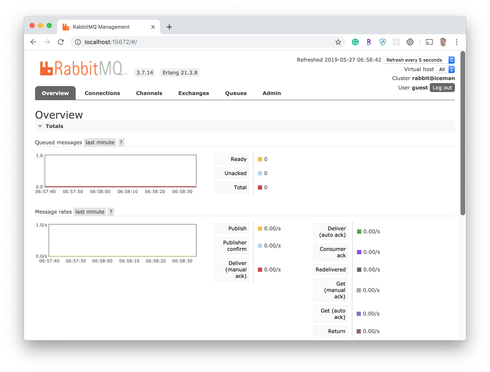
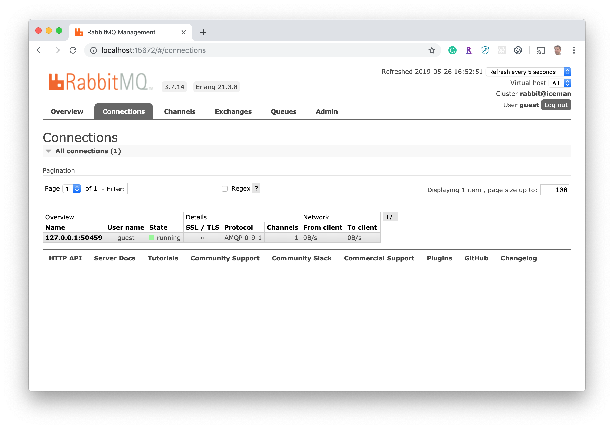
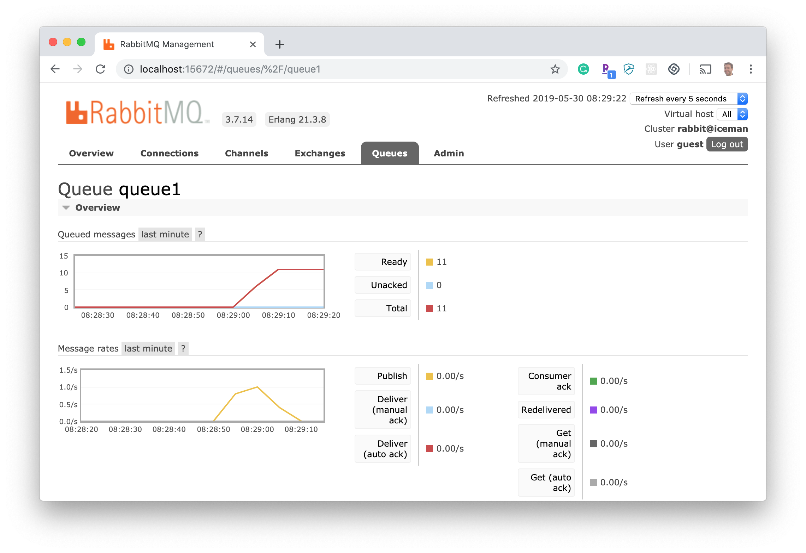
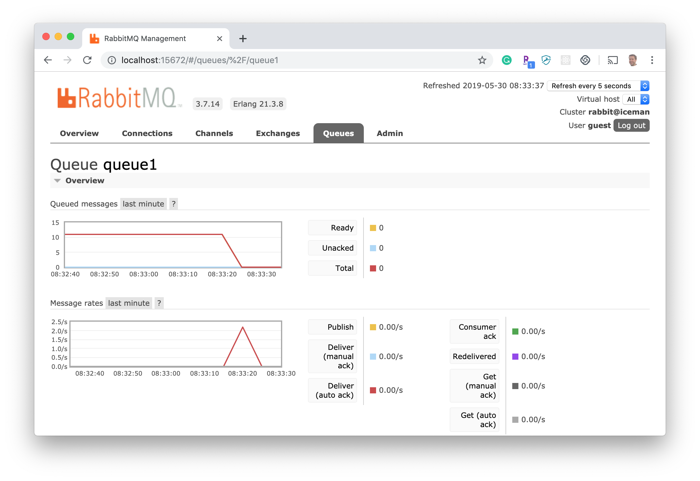
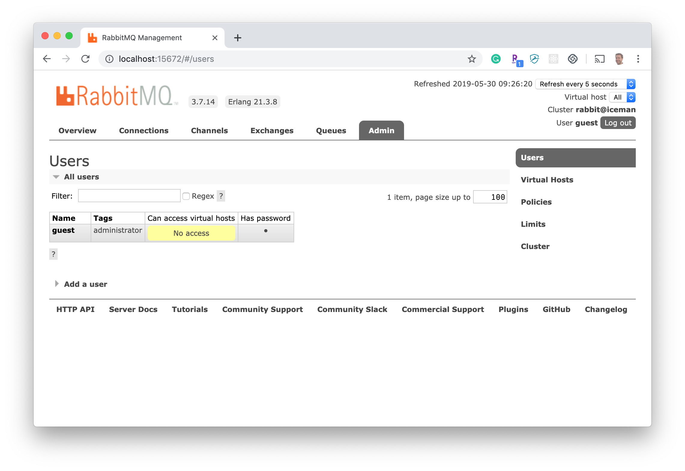

#  Messaging and Asynchronous Communication With RabbitMQ Lab

## Introduction

In this follow-along lab, we'll cover some of the basic administrative functions you can perform with RabbitMQ's [management UI](https://www.rabbitmq.com/management.html). The management UI lets you monitor messaging activity, manage users and permissions, join clusters, and more. It's packaged as a RabbitMQ plugin and enabled by default upon installation. 

-----

## Accessing the Management UI

1. Start the RabbitMQ server by running the `rabbitmq-server` command. 
1. Access the UI from your web browser at [http://localhost:15672/](http://localhost:15672/). 
1. Login with username `guest` and password `guest`. This is the [default administrator account](https://www.rabbitmq.com/access-control.html#default-state) for the server. You should see an overview screen that looks like this:
    
    

----    

## Monitoring

Let's monitor our connections and queue.

### Connections 

1. Click on the "Connections" tab. You'll notice that there isn't much going on. 
1. Start the `Receive.java` program from the previous lesson. When the receiver connects to the message broker, you'll see a new connection appear, as shown below:

    

1. Terminate the receiver. 
    
### Queues 

1. On the "Queues" tab, select `queue1`.
1. Build and run the `Sender` program included with this lab (not from the previous lesson) by running the commands below. It uses [Spring AMQP](https://spring.io/projects/spring-amqp) to publish messages in `queue1`. 

(Notice how much less boilerplate code is required in [`Sender.java`](./src/main/java/co/ga/rabbitmq/Sender.java) when we use Spring AMQP to send messages instead of the RabbitMQ Java client directly.)

    ```sh
    ./mvnw clean install
    java -jar ./target/rabbitmq-lab2-0.0.1-SNAPSHOT.jar --spring.profiles.active=rabbitmq-lab2,sender    
    ```

1. Because there are no receivers listening for messages in the queue, the messages will accumulate. You should see the message count displayed in the management UI, as shown here:

    

1. Now, let's run the receiver to consume the messages in the queue:

        

-----

## User Management and Permissions

RabbitMQ has powerful [access controls](https://www.rabbitmq.com/access-control.html). We won't get into all the details in this lesson; we'll just try out a few simple commands to clear and then restore the `guest` user's access permissions. 

### Setting Permissions to Read, Write, and Configure

1. Let's clear the `guest` user's permissions. Enter this command:

    ```sh
    rabbitmqctl clear_permissions guest
    ```

1. Try connecting the receiver as described above. You should see an error message like this:

    ```text
    [INFO] --- exec-maven-plugin:1.6.0:exec (default-cli) @ rabbitmq-lab1 ---
    Exception in thread "main" java.io.IOException
        at com.rabbitmq.client.impl.AMQChannel.wrap(AMQChannel.java:129)
        at com.rabbitmq.client.impl.AMQChannel.wrap(AMQChannel.java:125)
        at com.rabbitmq.client.impl.AMQChannel.exnWrappingRpc(AMQChannel.java:147)
        at com.rabbitmq.client.impl.AMQConnection.start(AMQConnection.java:403)
        at com.rabbitmq.client.impl.recovery.RecoveryAwareAMQConnectionFactory.newConnection(RecoveryAwareAMQConnectionFactory.java:64)
        at com.rabbitmq.client.impl.recovery.AutorecoveringConnection.init(AutorecoveringConnection.java:156)
        at com.rabbitmq.client.ConnectionFactory.newConnection(ConnectionFactory.java:1106)
        at com.rabbitmq.client.ConnectionFactory.newConnection(ConnectionFactory.java:1063)
        at com.rabbitmq.client.ConnectionFactory.newConnection(ConnectionFactory.java:1021)
        at com.rabbitmq.client.ConnectionFactory.newConnection(ConnectionFactory.java:1182)
        at co.ga.rabbitmq.Receive.main(Receive.java:24)
    Caused by: com.rabbitmq.client.ShutdownSignalException: connection error; protocol method: #method<connection.close>(reply-code=530, reply-text=NOT_ALLOWED - access to vhost '/' refused for user 'guest', class-id=10, method-id=40)
        at com.rabbitmq.utility.ValueOrException.getValue(ValueOrException.java:66)
        at com.rabbitmq.utility.BlockingValueOrException.uninterruptibleGetValue(BlockingValueOrException.java:36)
        at com.rabbitmq.client.impl.AMQChannel$BlockingRpcContinuation.getReply(AMQChannel.java:502)
        at com.rabbitmq.client.impl.AMQChannel.privateRpc(AMQChannel.java:293)
        at com.rabbitmq.client.impl.AMQChannel.exnWrappingRpc(AMQChannel.java:141)
        ... 8 more
    [ERROR] Command execution failed.
    org.apache.commons.exec.ExecuteException: Process exited with an error: 1 (Exit value: 1)    
    ```

You'll also see in the management UI "Admin" tab that the `guest` user has no access to the default virtual host, `/`, or any other virtual host:
   
    

1. Restore the `guest` user's access by running:

    ```sh 
    rabbitmqctl set_permissions guest ".*" ".*" ".*"    
    ```

1. Now, run the receiver again and observe that you can successfully connect and listen for messages.

-----

## Add a User 

Let's add a user. We'll run the commands below to create the user `alex`. Then, we'll grant that user access to queues on the default virtual host, `/`. Then, we'll let the user log in via the management UI. 

1. Add user (with a password): 

    ```sh
    rabbitmqctl add_user alex myPassw0rd 
    ```

1. Edit [`application.yml`](./src/main/resources/application.yml) by changing the `spring.rabbitmq.username` to `alex` and `spring.rabbitmq.password` to `myPassw0rd`.

1. Rebuild and rerun the sender:

    ```sh 
    mvn clean install
    java -jar ./target/rabbitmq-lab2-0.0.1-SNAPSHOT.jar --spring.profiles.active=rabbitmq-lab2,sender
    ```

1. You should see an error that looks something like this, because we haven't granted `alex` permission to access the vhost:

    ```text
    2019-05-30 09:55:01.288 ERROR 62365 --- [   scheduling-1] o.s.s.s.TaskUtils$LoggingErrorHandler    : Unexpected error occurred in scheduled task.
    
    org.springframework.amqp.AmqpConnectException: java.net.ConnectException: Connection refused (Connection refused)
        at org.springframework.amqp.rabbit.support.RabbitExceptionTranslator.convertRabbitAccessException(RabbitExceptionTranslator.java:62) ~[spring-rabbit-2.1.6.RELEASE.jar!/:2.1.6.RELEASE]
        at org.springframework.amqp.rabbit.connection.AbstractConnectionFactory.createBareConnection(AbstractConnectionFactory.java:509) ~[spring-rabbit-2.1.6.RELEASE.jar!/:2.1.6.RELEASE]
        at org.springframework.amqp.rabbit.connection.CachingConnectionFactory.createConnection(CachingConnectionFactory.java:700) ~[spring-rabbit-2.1.6.RELEASE.jar!/:2.1.6.RELEASE]
        at org.springframework.amqp.rabbit.connection.ConnectionFactoryUtils.createConnection(ConnectionFactoryUtils.java:214) ~[spring-rabbit-2.1.6.RELEASE.jar!/:2.1.6.RELEASE]
        at org.springframework.amqp.rabbit.core.RabbitTemplate.doExecute(RabbitTemplate.java:2073) ~[spring-rabbit-2.1.6.RELEASE.jar!/:2.1.6.RELEASE]
        at org.springframework.amqp.rabbit.core.RabbitTemplate.execute(RabbitTemplate.java:2047) ~[spring-rabbit-2.1.6.RELEASE.jar!/:2.1.6.RELEASE]
        at org.springframework.amqp.rabbit.core.RabbitTemplate.send(RabbitTemplate.java:994) ~[spring-rabbit-2.1.6.RELEASE.jar!/:2.1.6.RELEASE]
        at org.springframework.amqp.rabbit.core.RabbitTemplate.convertAndSend(RabbitTemplate.java:1060) ~[spring-rabbit-2.1.6.RELEASE.jar!/:2.1.6.RELEASE]
        at org.springframework.amqp.rabbit.core.RabbitTemplate.convertAndSend(RabbitTemplate.java:1042) ~[spring-rabbit-2.1.6.RELEASE.jar!/:2.1.6.RELEASE]
        at co.ga.rabbitmq.Sender.send(Sender.java:26) ~[classes!/:0.0.1-SNAPSHOT]
    ```

1. Grant `alex` access to configure, read, and write to all queues on the default vhost, `/`:

    ```sh 
    rabbitmqctl set_permissions alex ".*" ".*" ".*"
    ```

1. Finally, to let `alex` log in to the management UI, run this command to make `alex` an [`administrator`](https://www.rabbitmq.com/management.html#permissions):

    ```sh
    rabbitmqctl set_user_tags alex administrator
    ```

-----    

## Server Configuration and Logging 

Next, we'll override the default server configuration and watch the log files with `tail`.

### Set the Configuration File 

Start the server by running the `rabbitmq-server` command.

When you start the server, you'll see a message like this:

```text
Logs:   /usr/local/var/log/rabbitmq/rabbit@localhost.log
        /usr/local/var/log/rabbitmq/rabbit@localhost_upgrade.log
```

If we open up the first log file, we'll see something like this:    

```text
2019-05-25 08:00:23.517 [info] <0.280.0>
node           : rabbit@localhost
home dir       : /Users/alex
config file(s) : (none)
cookie hash    : K5rBJJcLEMRigJyRhDTjrA==
log(s)         : /usr/local/var/log/rabbitmq/rabbit@localhost.log
               : /usr/local/var/log/rabbitmq/rabbit@localhost_upgrade.log
database dir   : /usr/local/var/lib/rabbitmq/mnesia/rabbit@localhost
```     

Notice that there isn't a `config file` for our RabbitMQ node. It's using the default built-in configuration. Let's override that by creating [our own `config file`](./etc/rabbitmq/rabbitmq.conf) for RabbitMQ. But first, let's shut down our server.
 
To shut down a server:

```sh
# Enter Control-C in the terminal window where you started the server, or enter the command below:
 
rabbitmqctl stop
```

Now type these commands to create a `config file`:

```sh
cp  ./etc/rabbitmq/rabbitmq.conf /usr/local/etc/rabbitmq/rabbitmq.conf
```

Now, start the server again and inspect your log. You'll see that the `config file` was detected:

```text
2019-05-25 08:49:42.804 [info] <0.284.0>
node           : rabbit@localhost
home dir       : /Users/alex
config file(s) : /usr/local/etc/rabbitmq/rabbitmq.conf
cookie hash    : K5rBJJcLEMRigJyRhDTjrA==
log(s)         : /usr/local/var/log/rabbitmq/rabbit@localhost.log
               : /usr/local/var/log/rabbitmq/rabbit@localhost_upgrade.log
database dir   : /usr/local/var/lib/rabbitmq/mnesia/rabbit@localhost
```      

If you open up that log file, you'll see various configuration settings you can override. They are all commented out for this lab, but you can play around with them if you want. (Refer to the configuration manual [here](https://www.rabbitmq.com/configure.html#configuration-files).)

### Logging

The `log` file helps us find out what’s currently going on in the server (e.g., events around connection attempts, errors in responses, user creations/deletions, and so on). 

You can review the `log` file with tools such as `vi` and `grep`, and you can watch the `log` file using `tail` in real time. Here's how:

__Watch the `log` file in real time:__

```sh 
tail -f /usr/local/var/log/rabbitmq/rabbit@localhost.log 
```
        
__Search the `log` file for errors:__

```sh 
grep error /usr/local/var/log/rabbitmq/rabbit@localhost.log 
```

-----

## Additional Command Line Tools

You can also use [command line tools](https://www.rabbitmq.com/cli.html) to view the status of your vhosts, queues, exchanges, and bindings and perform other administrative functions. 

In addition to the ones we've already covered in this lab, here are some common operations:

- List queues:

    ```sh
    rabbitmqctl list_queues
    ``` 

- List users:

    ```sh
    rabbitmqctl list_users
    ``` 
        
- List vhosts:

    ```sh
    rabbitmqctl list_vhosts
    ``` 

### References

- [RabbitMQ Monitoring](https://www.rabbitmq.com/monitoring.html)
- [RabbitMQ Management](https://www.rabbitmq.com/management.html)
        
